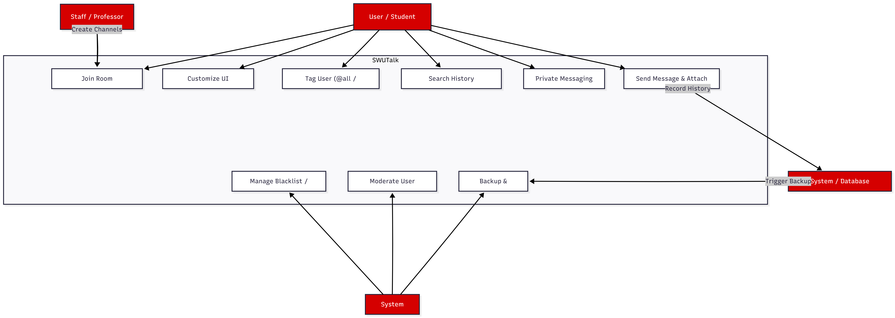
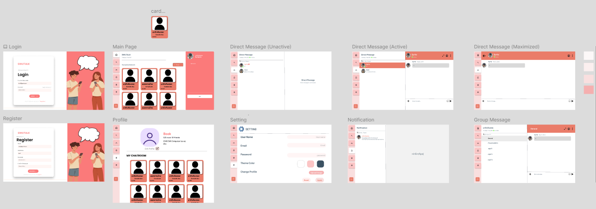
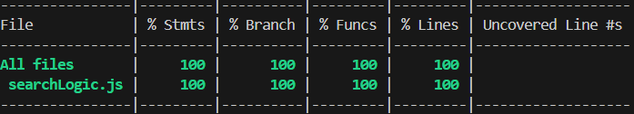
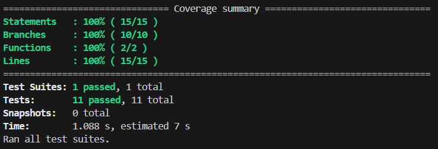
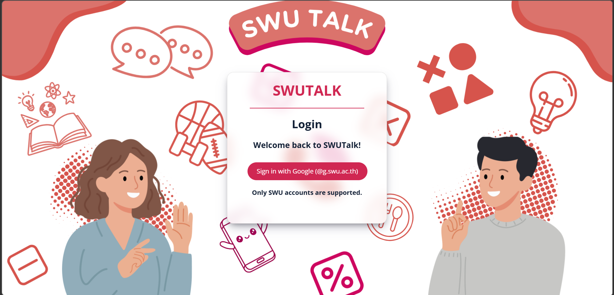
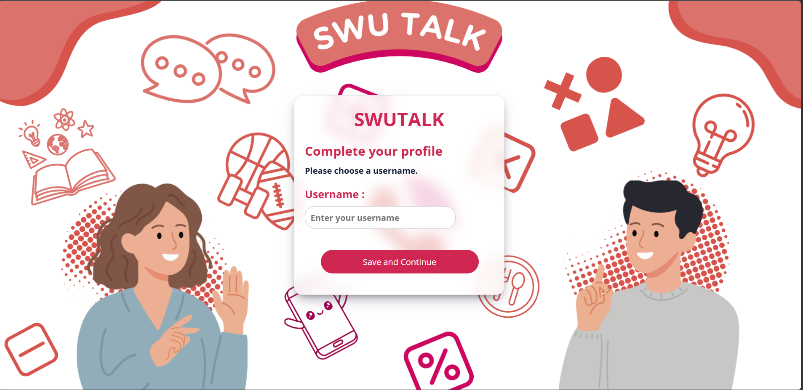
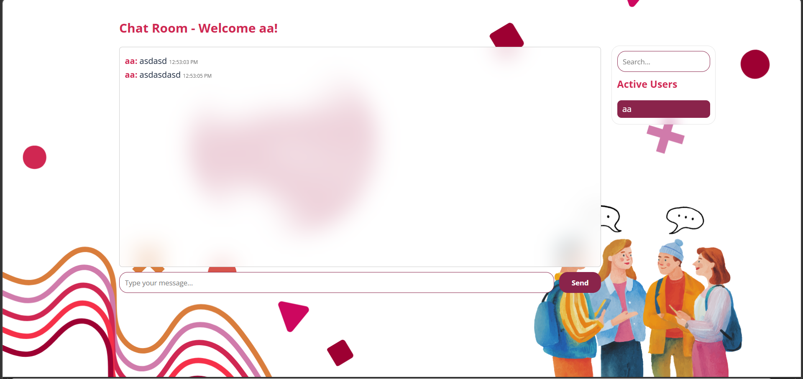

# swutalk
A Chatroom project for CP252

## ที่มาและความสำคัญ
  ในยุคปัจจุบันที่การสื่อสารดิจิทัลเป็นหัวใจสำคัญของการใช้ชีวิตในมหาวิทยาลัย การแลกเปลี่ยนข้อมูลข่าวสารระหว่างนิสิต บุคลากร และอาจารย์ภายในมหาวิทยาลัยศรีนครินทร์วิโรฒ (มศว) ยังคงมีความกระจัดกระจาย ข้อมูลสำคัญมักถูกกลืนหายไปในแอปพลิเคชันสนทนาทั่วไปที่ไม่ได้ออกแบบมาเพื่อการบริหารจัดการความรู้หรือการสร้างชุมชนทางวิชาการโดยเฉพาะ  
  SWUTalk จึงถูกพัฒนาขึ้นเพื่อเป็นแพลตฟอร์มกลางในการสื่อสาร (Communication Hub) ที่รวบรวมฟังก์ชันการพูดคุยแบบเรียลไทม์ (Chat) และการตั้งกระทู้แลกเปลี่ยนความคิดเห็น (Discussion Forum) เข้าไว้ด้วยกัน โดยมุ่งเน้นการสร้างสภาพแวดล้อมที่ปลอดภัย (Safe   Zone) ผ่านระบบจัดการคำไม่เหมาะสมและระบบ Admin ที่มีประสิทธิภาพ พร้อมทั้งเปิดโอกาสให้ผู้ใช้ปรับแต่งประสบการณ์การใช้งาน (Personalization) เพื่อตอบโจทย์ความหลากหลายของอัตลักษณ์นิสิต มศว  
  การเชื่อมโยงกับเป้าหมายการพัฒนาที่ยั่งยืน (SDGs)  
  โปรเจกต์ SWUTalk สอดคล้องกับเป้าหมาย SDGs ในมิติต่างๆ ดังนี้:  
  1.	SDG 4: Quality Education (การศึกษาที่เท่าเทียมและมีคุณภาพ)  
  ส่งเสริมการเรียนรู้ตลอดชีวิตและการแลกเปลี่ยนความรู้นอกห้องเรียนผ่านฟังก์ชันห้องแชทและกระทู้ที่ Staff หรืออาจารย์สร้างขึ้น ช่วยให้นิสิตเข้าถึงข้อมูลวิชาการและคำแนะนำได้ง่ายขึ้น  
  2.	SDG 9: Industry, Innovation, and Infrastructure (อุตสาหกรรม นวัตกรรม และโครงสร้างพื้นฐาน)  
  เป็นการพัฒนานวัตกรรมด้าน Software Infrastructure ภายในสถานศึกษา เพื่อเพิ่มประสิทธิภาพในการบริหารจัดการข้อมูลดิจิทัล (Data Management) และการรองรับการขยายตัวของผู้ใช้งาน (Scalability)  
  3.	SDG 11: Sustainable Cities and Communities (เมืองและชุมชนที่ยั่งยืน) การสร้างพื้นที่ชุมชนออนไลน์ (Digital Community) ที่เข้มแข็งภายในมหาวิทยาลัย ช่วยเสริมสร้างความสัมพันธ์และความร่วมมือระหว่างสมาชิกในรั้ว มศว ทั้งที่ประสานมิตรและองครักษ์ ให้เป็นหนึ่งเดียวกันมากขึ้น  
  ดังนั้น การพัฒนาโครงงาน SWUTalk นี้ จึงไม่เพียงแค่เป็นการสร้างเครื่องมือสื่อสารหรือแพลตฟอร์มสนทนาภายในมหาวิทยาลัยเท่านั้น แต่ยังเป็นการยกระดับระบบนิเวศดิจิทัล (Digital Ecosystem) ของมหาวิทยาลัยศรีนครินทร์วิโรฒให้มีความเข้มแข็ง ปลอดภัย และยั่งยืน ผ่านการ  ประยุกต์ใช้เทคโนโลยีเพื่อตอบสนองต่อเป้าหมายการพัฒนาในระดับสากล อันจะนำไปสู่การสร้างชุมชนแห่งการเรียนรู้และการอยู่ร่วมกันที่มีประสิทธิภาพ พร้อมก้าวสู่การเป็น Smart University อย่างเต็มรูปแบบในอนาคต  

## จุดประสงค์ของโครงงาน  
1.	เพื่อออกแบบและพัฒนาแอปพลิเคชัน SWUTalk ให้เป็นสื่อกลางในการสื่อสารและแลกเปลี่ยนองค์ความรู้ภายในมหาวิทยาลัย
2.	เพื่อพัฒนาระบบจัดการเนื้อหาและคัดกรองคำไม่เหมาะสม เพื่อสร้างสภาพแวดล้อมการสื่อสารที่ปลอดภัยและสร้างสรรค์  
3.	เพื่อพัฒนาระบบสารสนเทศที่มีประสิทธิภาพในการสืบค้นข้อมูลย้อนหลังและการจัดเก็บไฟล์สื่อประสม (Multimedia)  
4.	เพื่อศึกษาและประยุกต์ใช้เทคโนโลยีการบริหารจัดการฐานข้อมูลที่รองรับการสำรองและการกู้คืนข้อมูล (Backup and Recovery) ในกรณีวิกฤต

## ประโยชน์ที่คาดว่าจะได้รับ  
1.	มหาวิทยาลัยมีแพลตฟอร์มการสื่อสารที่เป็นเอกภาพ ช่วยลดความซับซ้อนและช่องว่างในการกระจายข้อมูลข่าวสาร  
2.	นิสิตและบุคลากรสามารถเข้าถึงคลังความรู้และไฟล์เอกสารประกอบการเรียนการสอนได้อย่างสะดวกรวดเร็วและเป็นระบบ  
3.	ช่วยส่งเสริมโครงสร้างพื้นฐานด้านดิจิทัลของมหาวิทยาลัยให้มีความพร้อมต่อการขยายตัวในอนาคตตามมาตรฐานเทคโนโลยีสารสนเทศ  
4.	ช่วยเพิ่มความรู้และประสบการณ์ให้แก่ผู้พัฒนา เพื่อนำไปต่อยอดต่อไป  

## ขอบเขตโครงงาน  
การดำเนินโครงงานในครั้งนี้มีขอบเขตครอบคลุมการทำงาน ดังนี้:  
3.1 ขอบเขตด้านการพัฒนาระบบ 
1.	ระบบสามารถรองรับการสนทนาทั้งแบบส่วนตัวและแบบกลุ่ม โดยสามารถแนบไฟล์ภาพ วิดีโอ และเอกสารได้  
2.	ระบบมีฟังก์ชันการแจ้งเตือนบุคคล (Tagging) ในรูปแบบ @all และ @username  
3.	ระบบมีช่องทางการค้นหาข้อความย้อนหลังตามคำสำคัญ (Keyword) และช่วงเวลา (Date Range)  
4.	ระบบรองรับการเข้าสู่ห้องสนทนาผ่านลิงก์เชื่อมโยง (Direct Link)   
5.	มีระบบส่วนหลังบ้าน (Admin Dashboard) สำหรับการจัดการ Blacklist, การระงับสิทธิ์ (Mute) และการเชิญผู้ใช้ออกจากกลุ่ม (Kick)
3.2 ขอบเขตด้านประสิทธิภาพระบบ 
1.	พัฒนาในรูปแบบ Web Application ที่มีลักษณะการออกแบบเป็น Responsive Design  
2.	ผู้ใช้งานสามารถปรับเปลี่ยนรูปแบบส่วนต่อประสานผู้ใช้ (User Interface) ได้แก่ โทนสี (Theme) และรูปแบบตัวอักษร (Font)  
3.	ระบบต้องรองรับปริมาณผู้ใช้งานจำนวนมากพร้อมกัน (Concurrent Users) โดยมีการรักษาเสถียรภาพของระบบ (Availability)  
4.	มีกระบวนการสำรองข้อมูล (Data Backup) และแผนการกู้คืนข้อมูล (Recovery Plan) ที่เป็นระบบ  

## อธิบายกระบวนการทำงาน โดยใช้ Process, Methods, and Tools อย่างไร 
### 1.	Process  
1.1 การวิเคราะห์ความต้องการและรวบรวมปัญหา (Requirement Analysis): รวบรวมข้อมูลและความต้องการจากผู้ใช้งานกลุ่มเป้าหมาย เพื่อนำมาจัดหมวดหมู่ภาระงาน (Issue) และวางแผนการดำเนินงานในระยะยาว   
1.2 การออกแบบโปรแกรมต้นแบบ (Prototyping): นำข้อมูลที่รวบรวมได้มาออกแบบส่วนต่อประสานผู้ใช้ (User Interface) และจำลองการทำงานของระบบเพื่อเห็นภาพรวมก่อนการพัฒนาจริง   
1.3 การพัฒนาและทดสอบระบบ (Implementation and Testing): ดำเนินการเขียนรหัสโปรแกรม (Coding) โดยเน้นการทำงานร่วมกันผ่านระบบควบคุมเวอร์ชัน และทำการทดสอบการทำงานของเว็บไซต์อย่างละเอียดเพื่อตรวจสอบความถูกต้อง   
1.4 การจัดทำเอกสารประกอบโครงงาน (Documentation): รวบรวมข้อมูลการออกแบบและขั้นตอนการทำงานทั้งหมด เพื่อจัดทำรายงานทางวิชาการและคู่มือการใช้งานระบบ  
1.5 การสรุปผลและประเมินการทำงาน (Project Retrospective):   ดำเนินการประชุมเพื่อสรุปบทเรียนจากการทำงาน วิเคราะห์ปัญหาที่พบ    และหาแนวทางแก้ไขเพื่อพัฒนาประสิทธิภาพของทีม   
1.6 ตั้งชื่อ branch ประกอบไปด้วย main ที่เป็นงานหลัก เเละ branch เเยกของเเต่ละคน book,sprite,atom  
### 2.	Method  
2.1 วิธีการเก็บความต้องการ: ดำเนินการสอบถามข้อมูลจากนิสิตและบุคลากรกลุ่มต่างๆ ผ่านการนัดประชุมร่วมกัน จากนั้นนำความต้องการที่ได้มาสร้างเป็น "Issue" ในระบบจัดการงาน เพื่อให้สามารถติดตามสถานะการดำเนินงานได้อย่างเป็นระบบ   
2.2 วิธีการพัฒนาภาพลักษณ์ระบบ: ใช้วิธีการออกแบบเชิงทัศนวิสัยด้วยโปรแกรมสำเร็จรูป เพื่อกำหนดโครงสร้างและลำดับการใช้งาน (User Flow)  
2.3 วิธีการพัฒนาโปรแกรมต้นแบบ: ใช้โปรแกรม IDE ที่รองรับการพัฒนาแอปพลิเคชันสมัยใหม่ เพื่อสร้างระบบต้นแบบที่มีการทำงานพื้นฐานตามที่กำหนด  
2.4 วิธีการเขียนรหัสโปรแกรมร่วมกัน: ใช้แพลตฟอร์มบริหารจัดการรหัสต้นฉบับ (Source Code Management) เพื่อให้สมาชิกในทีมสามารถแก้ไขโปรแกรมในไฟล์เดียวกันได้โดยไม่เกิดความซ้ำซ้อนและทำการทดสอบระบบผ่านสภาวะแวดล้อมจำลอง  
2.5 วิธีการจัดทำเอกสาร: ใช้ระบบการจัดการเอกสารผ่านระบบคลาวด์ (Cloud-based Documentation) เพื่อให้สมาชิกทุกคนสามารถเข้าถึง แก้ไข และปรับปรุงข้อมูลในเล่มรายงานร่วมกันได้แบบเรียลไทม์  
2.6 วิธีการบันทึกการประชุม: ใช้วิธีการบันทึกวิดีโอในทุกครั้งที่มีการประชุมสรุปงาน   (Retrospective) เพื่อนำข้อมูลมาวิเคราะห์ย้อนหลังและแบ่งปันความคืบหน้าภายในทีม   
2.7 วิธีการ scrum : คุยกันอย่างต่อเนื่องทั้งต่อหน้าเเละออนไลน์  
### 3.	Tools  
3.1 เครื่องมือด้านการออกแบบ (Design Tool): ใช้โปรแกรม Figma สำหรับการสร้างภาพร่าง (Wireframe) และโปรแกรมต้นแบบ (High-fidelity Prototype)  
3.2 เครื่องมือด้านการพัฒนา (IDE): ใช้โปรแกรม Visual Studio Code เป็นเครื่องมือหลักในการเขียนรหัสโปรแกรมและการจัดการไฟล์ภายในโครงการ  
3.3 เครื่องมือด้านการจัดเก็บและควบคุมรหัส (Version Control): ใช้แพลตฟอร์ม GitHub เป็นตัวกลางในการส่งข้อมูล รวบรวมรหัสต้นฉบับ และบริหารจัดการ Issue ต่างๆ ภายในทีม  
3.4 เครื่องมือด้านการจัดการเอกสาร (Documentation Tool): ใช้โปรแกรม Microsoft Word และ Google Docs ในการจัดทำเล่มรายงานโครงงานและเอกสารเชิงเทคนิค  
3.5 เครื่องมือด้านการสื่อสารและบันทึกข้อมูล (Communication and Recording): * ใช้โปรแกรม Discord เป็นช่องทางหลักในการสื่อสารและประชุมทางไกล และ ใช้โปรแกรม OBS Studio สำหรับการบันทึกวิดีโอหน้าจอในขณะประชุมและขณะสาธิตการใช้งานระบบ เพื่อนำไปใช้ประกอบการทำ Retrospective  

## Functional Requirements 
1. ระบบต้องรองรับการส่งข้อความพื้นฐาน และการแนบไฟล์ประเภทรูปภาพ, วิดีโอ และไฟล์เอกสารอื่นๆ เข้าไปในห้องแชทได้
2. ผู้ใช้สามารถสร้างบัญชี ลงทะเบียน และเข้าสู่ระบบด้วยอีเมลหรือเบอร์โทรศัพท์
3. มีระบบ role ให้ชัดเจน โดย role เริ่มต้นเป็น นิสิต เเละ role อื่นๆจะจัดการเเจกเเจงให้โดยผู้ดูเเล
4. ระบบต้องมีกลไกการบันทึกประวัติการสนทนาย้อนหลังตามเงื่อนไขที่กำหนด (เช่น ระยะเวลา หรือ ปริมาณข้อมูล)
5. ระบบต้องมีฟังก์ชันการ Tag บุคคล เช่น @all เพื่อแจ้งเตือนทุกคนในกลุ่ม หรือ @username เพื่อระบุตัวตนบุคคลนั้นๆ
6. ระบบต้องมีระบบหลังบ้านสำหรับ Admin เพื่อจัดการคำที่ไม่เหมาะสม (Blacklist/Reserved Words) และมีความสามารถในการระงับสิทธิ์ (Mute) หรือไล่ออก (Kick) ผู้ใช้งานที่ทำผิดกฎ
7. ผู้ใช้งานต้องสามารถพูดคุยกันแบบส่วนตัวได้ ผ่านช่องทาง Web Application ได้
8. ระบบต้องมีช่องค้นหาเพื่อให้ผู้ใช้สามารถค้นหาข้อความย้อนหลังตามคำสำคัญ (Keyword) หรือวันเวลาที่พิมพ์ได้
9. ระบบต้องมีวิธีการเข้าร่วมห้องแชทผ่านการคลิกลิงก์หรือการกดติดตาม (Subscribe) ช่องที่ Staff/อาจารย์ สร้างไว้

## Non-Functional Requirements
1. Usability & Customization (UI/UX): หน้าจอผู้ใช้งานต้องมีความทันสมัยและใช้งานง่าย ผู้ใช้สามารถปรับแต่งหน้าตา (Theme) ได้เองหรือเลือกจาก Template ที่ระบบมีให้และสามารถเปลี่ยนรูปแบบตัวอักษร (Font) ได้ตามความชอบ
2. Scalability & Availability: ระบบต้องรองรับการใช้งานจากผู้ใช้จำนวนมากพร้อมกันและต้องพร้อมใช้งานตลอดเวลาโดยมีโอกาสล่มน้อยที่สุด
3. Reliability & Data Recovery (Backup): ระบบต้องมีกระบวนการสำรองข้อมูล (Backup) ที่สม่ำเสมอและสามารถกู้คืนข้อมูล (Recovery) กลับมาได้ทันทีเมื่อเกิดปัญหาทางเทคนิค
4. Security ข้อมูลผู้ใช้และการชำระเงินต้องได้รับการเข้ารหัส ป้องกันการเข้าถึงโดยไม่ได้รับอนุญาต และปฏิบัติตามมาตรฐาน PDPA

## Use Case Diagram 
  

## Front-end Design

## การทำงานของโปรเเกรม 
1. มี GET กี่ Method?  
ในไฟล์ app.js มีการประกาศ GET method หรือ Endpoint ทั้งหมด 7 เส้นทาง (Routes) ดังนี้:  
app.get('/') - หน้าแรก (Index) / หน้าล็อกอิน  
app.get('/register') - หน้าลงทะเบียนเดิม แต่ปัจจุบันถูกสั่งให้ Redirect กลับไปที่หน้าแรก (/)  
app.get('/chat') - หน้าห้องแชทหลัก  
app.get('/setup-profile') - หน้าสำหรับตั้งค่า Username หลังจากล็อกอินผ่าน Google สำเร็จ  
app.get('/auth/google') - เริ่มต้นกระบวนการล็อกอินด้วย Google OAuth  
app.get('/auth/google/callback') - เส้นทางรับ Callback หลังจาก Google ยืนยันตัวตนสำเร็จ (เพื่อตรวจสอบและทำการ Redirect ไปหน้าต่อๆ ไป)  
app.get('/logout') - สำหรับออกจากระบบ  
2. มี POST กี่ Method?  
มีการประกาศ POST method ไว้ 1 เส้นทาง :  
app.post('/setup-profile') - ใช้สำหรับบันทึกข้อมูล Profile (ตัว Username) หลังจากผู้ใช้ตั้งค่าชื่อของตัวเอง  
3. ใช้ Template อย่างไร?  
ระบบใช้ EJS (Embedded JavaScript) เป็น Template Engine โดยตั้งค่าดังนี้:  
javascript  
app.set('view engine', 'ejs');  
app.set('views', path.join(__dirname, 'views'));  
หมายความว่าตัวโปรเจกต์จะเรียกโฟลเดอร์ views/ เพื่อดึงไฟล์ .ejs มาแสดงผล  
การส่งข้อมูลจากฝั่ง Server ไปยังผู้ใช้ เวลาแสดงหน้าตาเว็บไซต์ต่างๆ จะใช้การ Render ไฟล์ EJS (เช่น index.ejs, chat.ejs) ร่วมกับข้อมูลต่างๆ ส่งไปแสดงที่ฝั่ง Client 
4. มีการเรียก API หรือไม่อย่างไร?  
Third-party API: มีการเรียกใช้ Google OAuth 2.0 API ผ่านไลบรารี passport-google-oauth20 เพื่อทำระบบ Login ด้วย Google ซึ่งจะคอยดึงข้อมูล Profile ของผู้ใช้มา (อย่างเช่น Email และ ID) และระบบมีการดักกรองว่าจะยอมให้เข้าใช้งานได้ก็ต่อเมื่ออีเมลนั้นลงท้ายด้วย @g.swu.ac.th เท่านั้น  
WebSocket (Real-time API): มีการใช้ Socket.io เปิดช่องทางสื่อสาร 2 ทาง (Two-way communication) สำหรับแชทแบบ Real-time เช่น ส่งอีเวนต์ join, chat message, disconnect เป็นต้น  
5. มีการคำนวณหรือประมวลผลอะไรบ้าง?  
ระบบไม่ได้มีการคำนวณทางคณิตศาสตร์ที่ซับซ้อน แต่มีกระบวนการประมวลผลโลจิกการจัดการแชท ดังนี้: 
String Matching & Validation: ตอน Login ด้วย Google จะมีการตรวจสอบ String อีเมลว่าลงท้ายด้วย @g.swu.ac.th หรือไม่  
Session & Routing Logic: ระบบมีการประมวลผลเช็คว่า User มี Username แล้วหรือยัง ถ้ายังไม่มีจะ Redirect ไปบังคับกรอกที่หน้า /setup-profile  
Time Formatting: เมื่อมีแชทถูกส่งเข้ามา จะมีการประมวลผลสร้างเวลา ณ ตอนนั้น โดยใช้ new Date().toLocaleTimeString() เพื่อแนบเวลาไปกับข้อความที่ส่ง  
Managing Arrays/Objects: มีการจัดการ List ผู้ใช้ออนไลน์ เช่นการเอาชื่อใส่ (User.addUser) และเอาชื่อออก (User.removeUser) เมื่อผู้ใช้คนนั้นหลุดการเชื่อมต่อ  แล้วค่อยส่งรายชื่อแจ้งทุกคนในห้อง  

## Test case
  
  

## Bug เเละ ปัญหาที่ถูกพบ  
1. ในตอนค้นหายังไม่รองรับการ search มากกว่า 1 filer (เช่น username เเละ date พร้อมๆกัน)  

## หน้า Website
  
  
  

## สรุป Requriement   
คลิปวิดีโอ : https://www.youtube.com/watch?v=rnKZ1QF17bc  
สิ่งที่ได้จากการเก็บ requirement :  
  1. SWUTalk เป็นแพลตฟอร์มแชทแบบ web application ที่ออกแบบมาเพื่อให้นักศึกษาและอาจารย์ในมหาวิทยาลัยสามารถสื่อสารกันได้สะดวก ไม่ว่าจะเป็นการถามตอบในห้องเรียน ประกาศข่าวสาร หรือคุยงานกลุ่ม โดยมีระบบจัดการที่เหมาะกับการใช้งานในสถาบันการศึกษา
  2. หลังจากการคุยพบว่า มี functional requirement ที่ได้รับมา 9 เเละ non-functional requirement 4
  3. function หลักๆที่สำคัญตอนนี้ประกอบไปด้วย login/register , ระบบเเชทห้องที่ตั้งห้องให้คนเข้ามาคุย ,  ระบบต่างๆของ Admin สำหรับจัดการความเรียบร้อย เเละสำหรับที่เหลือสามาถทยอยทำตามมาทีหลังได้ เเต่โฟกัสที่ 3 function นี้หลักๆ

## สรุป Retrospective  1
คลิปวิดีโอ : https://youtu.be/PBT8URJ8dpU  
สิ่งที่ได้จากการคุยกันใน retro :  
  ตรวจสอบความเข้าใจภาพรวมของโปรเจคและการทำงานของสมาชิกภายในกลุ่ม โดยมีการทบทวนเป้าหมายและ Requirement ที่สำคัญหลักๆ ซึ่งสมาชิกทุกคนเข้าใจไปในทางเดียวกันและจัดการกับ Sprint1 อย่างเสร็จสมบูรณ์ภายใต้หน้าที่ที่ได้รับ มีการแลกเปลี่ยนข้อสงสัยและเสนอแนวทางการแก้ไขในกรณีต่างๆ — ยกตัวอย่างเมื่อ Requirement หลังตรวจพบมีการปรับปรุงแก้ไข Use Case Diagram อาจมีการพิจารณาปรับเปลี่ยนโครงสร้าง — และมีการรายงานแนะแนวสิ่งที่อาจปรับเปลี่ยนภายในกลุ่มอย่างการบริหารจัดการงานเพื่อมิให้ฝ่ายใดฝ่ายหนึ่งทำงานหนักจนเกินไปและสามารถแบ่งงานให้เสร็จสิ้นรวดเร็วมากขึ้น  
  จึงสรุปเนื้อหาประชุม Retrospective ดังต่อไปนี้:  
  1. เราได้หลังจากทำงานเเละสรุปทุกอย่างมาว่า 9 Functional Requriement , 4 Non-Functional Requirement เเละ 17 User stories  
  2. Requirement บางอันอาจจะต้องดูอีกทีเพราะความยากในการนำไปปฎิบัติภายในระบบ  
  3. ทุกคนเข้าใจการทำงานได้ด้วยดีเเละแลกเปลี่ยนปัญหาเล็กน้อยที่พบเจอเกี่ยวข้องกับงาน  

## สรุป Retrospective 2  
คลิปวิดีโอ : https://youtu.be/hBInNGhE9vU  
สิ่งที่ได้จากการคุยกันใน retro :  
  1. การทำงานรอบนี้ราบรื่นเเละเเก้ปัญหาเรื่องการเเบ่งงานไม่เท่ากันในรอบก่อนได้  
  2. ปัญหานี่เจอเป็นเรื่องเทคนิคมากกว่า ควรจะศึกษา tools มากกว่านี้  
